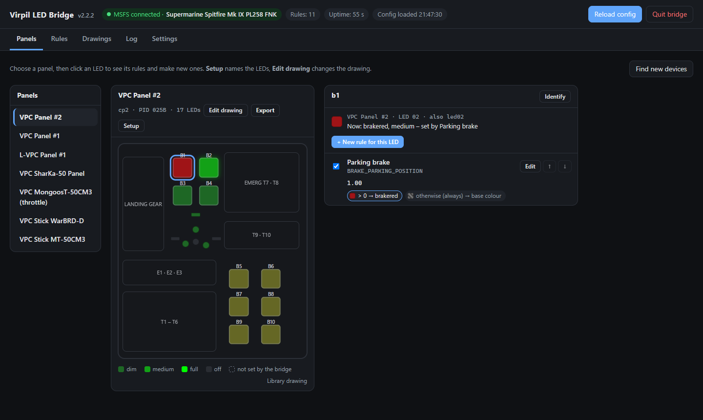
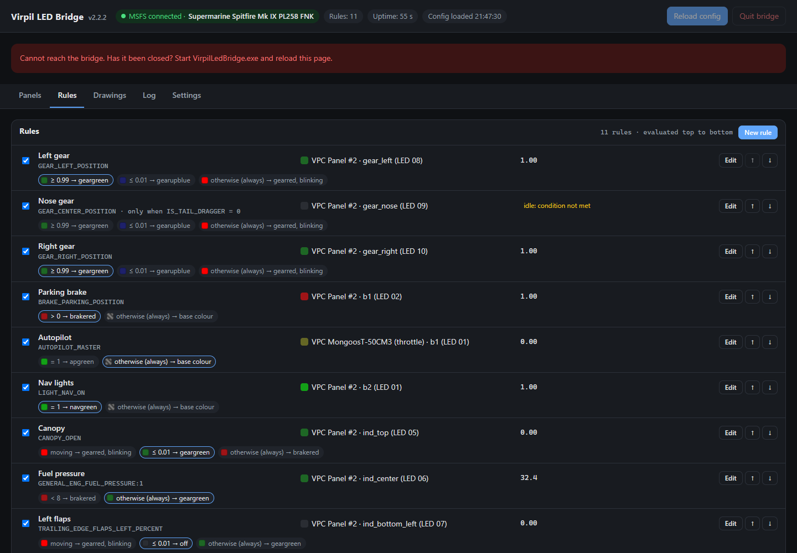
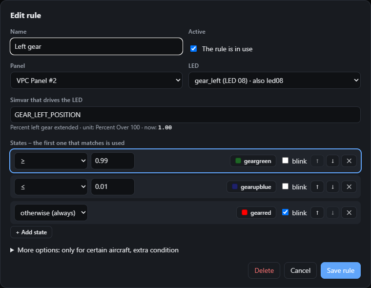

# Virpil LED Bridge for MSFS 2020/2024

Drives the LEDs on Virpil controllers from what happens in MSFS. The program runs in the background on your PC and:

- **reads MSFS directly** via SimConnect, using rules you set up in the control panel (stored in `config.json`), and/or
- **accepts commands** over a local API (HTTP and UDP), from SPAD.neXt, Stream Deck, a script or the browser.

The LEDs themselves are driven through Virpil's own `VPC_LED_Control.exe`, which comes with the VPC Software Suite.

## ⬇️ Download

**[Download the latest version (VirpilLedBridge-v2.2.2.zip)](https://github.com/eirikosten75/virpil-led-bridge/releases/download/v2.2.2/VirpilLedBridge-v2.2.2.zip)**
– or see all versions under [Releases](https://github.com/eirikosten75/virpil-led-bridge/releases).

The zip contains `VirpilLedBridge.exe` (no Python needed), `config.example.json`, this README and the licence. Unzip it to a folder of your choice and follow the quick start below. On the first start the bridge finds
your Virpil devices and makes your own `config.json` (section 2). Updating later never overwrites it.

📖 **New here?** The [wiki](https://github.com/eirikosten75/virpil-led-bridge/wiki) has a step-by-step
[getting started guide](https://github.com/eirikosten75/virpil-led-bridge/wiki/Getting-started), a
[rule cookbook](https://github.com/eirikosten75/virpil-led-bridge/wiki/Rule-cookbook), tips for
[using LVARs](https://github.com/eirikosten75/virpil-led-bridge/wiki/Using-LVARs) and an
[FAQ](https://github.com/eirikosten75/virpil-led-bridge/wiki/FAQ-and-troubleshooting).

## Screenshots

The Panels tab – your panels on the left, the chosen panel with its LEDs live in the middle, and the rules for the LED
you click on the right:

<picture>
  <source media="(prefers-color-scheme: light)" srcset="docs/images/overview-light.png">
  
</picture>

The Rules tab – every rule with its current value from MSFS and the state that applies right now:

<picture>
  <source media="(prefers-color-scheme: light)" srcset="docs/images/rules-light.png">
  
</picture>

The rule editor – a simvar (or LVAR), the LED, and the states with their colours:

<picture>
  <source media="(prefers-color-scheme: light)" srcset="docs/images/rule-editor-light.png">
  
</picture>

## 1. Quick start

1. Install the **VPC Software Suite VPC-JOY-20261027 or newer** from Virpil (it contains `VPC_LED_Control.exe`), and
   **update the firmware** of your Virpil devices with its VPC Configuration Tool. This is required from version 2.0:
   the bridge uses the LED numbers of that firmware (see section 2).
2. Plug in your Virpil devices, and unzip the files to a folder of your choice.
3. Double-click `VirpilLedBridge.exe`. It needs no Python and has no console window. On the first start it finds
   your Virpil devices and writes `config.json` next to the exe (see section 2).
4. Double-click the **tray icon** (it may be hidden under the ^ arrow) to open the control panel
   at http://127.0.0.1:8765/.
5. If the log says it cannot find `VPC_LED_Control.exe`, fix `vpc_led_control.exe` in `config.json`
   (normally `C:\Program Files (x86)\VPC Software Suite\tools\VPC_LED_Control.exe`) and press *Reload config*.

The bridge connects to MSFS automatically when the sim starts, and reconnects if the connection drops.

**Start with Windows:** tick *Start with Windows* in the tray icon's menu or in the control panel's *Settings* tab. This adds
an entry for your Windows user only (`HKCU\Software\Microsoft\Windows\CurrentVersion\Run`, no admin rights needed), and
unticking removes it again. It points to the exe where it is now; if you move the exe, tick it again. You can also see
and turn it off under Windows *Settings → Apps → Startup*.

## 2. Set up your own devices

**Automatic detection.** When there is no `config.json`, the bridge makes one from the Virpil devices that are plugged
in (USB VID `3344`):

- Panels it already knows (Control Panel #1 and #2, SharKa-50, MongoosT-50CM3 – see `config.example.json`) get
  checked LED names, a drawing and example rules (gear, flaps, parking brake, lights and more). They are recognised by
  USB PID, or by product name if the PID has been changed.
- Other devices get the LEDs listed in their newest VPC Configuration Tool profile
  (`%LOCALAPPDATA%\VIRPIL\PROFILES`), named `led01`, `led02` … If there is no profile (or it does not list the LEDs), the bridge guesses LEDs 01–20;
  check them with *Walk through one by one* below.
- **Stick bases** (and other bases without LEDs of their own) are listed too, with the four LEDs a grip can have:
  `grip_led1`–`grip_led4` (commands 01–04). They are not ticked, since many grips have no LEDs. Grips are swapped
  between bases, so the LEDs follow the grip: check which ones yours has with *Walk through one by one*, and choose a
  grip drawing (e.g. *FLNKR Grip*) with *Use a library drawing* in the *Drawings* tab. If the base's VPC profile says
  which grip it has and the library knows that grip (e.g. *VPC WarBRD Grip*), its drawing and LED names are used
  straight away.
- Devices whose profile has no LEDs at all (not even grip LEDs) are left out.
- Plugged in a new device later? Press **Find new devices** in the *Panels* tab (or *Settings*) and tick the ones to add.
  Nothing already in your `config.json` is changed.

`config.json` is yours: it is not in the zip, so an update never overwrites it. To start again from scratch, rename
it and restart the bridge.

`config.json` describes each Virpil device by its USB `vid`/`pid` (Virpil's VID is `3344`; VPC Configuration Tool shows
the PID) and lists its LEDs by **command number** – the number `VPC_LED_Control.exe` uses for that LED, the same as
VPC Configuration Tool shows. With firmware 20261027 the LEDs on the board are **01–20** and slave boards start at 21.

**Older firmware** numbered the board LEDs 05–24. Version 2.0 requires firmware 20261027: when it starts with a
`config.json` from an older version, it converts the numbers once (05–24 → 01–20; the old file goes to `backups`, and
LED names and rules are unchanged). The top bar warns if the VPC software is older than 20261027, or if a device's VPC
profile is in the old form (a sign of old firmware).

You do not need to work out which physical LED is which by hand:

- **Setup** (button on each device in the *Panels* tab): click an LED and it blinks white on the physical panel.
  Give it a name (several names are separated by commas) and press Enter.
- **Walk through one by one** blinks every LED on the device in turn – type a name, press Enter, next.
- **Try command number** finds LEDs that are not in the config yet (01–54) and adds them.
- A name used by a rule can be swapped for exactly one new name – the rule is then updated too.
- Before every save, a copy of `config.json` is put in the `backups` folder (the latest 20 are kept).

**To test one LED by hand** from a command prompt:
```
"C:\Program Files (x86)\VPC Software Suite\tools\VPC_LED_Control.exe" 3344 025B 01 00 FF 00
```
If that LED lights green, the format is right. LEDs that should be driven from outside may need to be configured in
VPC Configuration Tool so that the buttons themselves do not control them.

**Brightness:** Virpil LEDs only have four levels per colour channel: off (00), dim (40), medium (80) and full (FF).
Other values are rounded to the nearest of these (tested: 20 turns the LED off).

## 3. The control panel

The control panel has five tabs. The page remembers the last one, and you can link straight to one
(e.g. http://127.0.0.1:8765/#rules).

- **Top bar (always shown):** MSFS connection and aircraft, **LED control**, number of rules in use, uptime, when the
  config was last loaded, and – when aircraft profiles are on – the profile in use (section 4). The LED control status
  is green (*LEDs OK · 5/5*) when `VPC_LED_Control.exe` is found, the last write to a panel worked and all devices in
  `config.json` are plugged in; yellow when a device is missing or nothing has been written yet; red when the exe is
  not found or writes fail. Hover over it for the path, the number of writes and failures, the last error and which
  devices are not plugged in. *Reload config* applies changes made to
  `config.json` by hand without a restart. If the file is invalid, the old config is kept and you are told what is
  wrong. *Quit bridge* sets the LEDs to their base colours and exits.
- **Panels:** laid out like SPAD.neXt – the names of your devices on the left, the chosen device with its LEDs live in
  the middle, and on the right the rules for the LED you click, with *+ New rule for this LED* (the rule editor opens
  with that device and LED filled in), *Identify* and the LED's colour right now. *Setup* names the LEDs; *Find new
  devices* adds devices.
- **Rules:** each rule with its current value from MSFS and which state applies right now. Turn rules on/off, move them
  up/down, or press *Edit* / *New rule*. Rules are evaluated top to bottom; if several rules drive the same LED, the last one wins.
  With aircraft profiles on, the rules for all aircraft and each profile have their own tab here.
- **Rule editor:** search about 800 simvars (with description, unit and live value), choose device and LED, and set up
  states (condition → colour, optionally blinking). The colour picker only offers the four brightness levels the
  panels actually have. *More options* has “only aircraft whose name contains …” and an extra condition on another
  simvar (e.g. only aircraft without a tailwheel). The state that applies right now is highlighted while you edit.
- **Devices:** panels that have a drawing (in the built-in library: Control Panel #1 and #2, SharKa-50 Panel and the
  MongoosT-50CM3 throttle – or one you made yourself) are drawn with their LEDs where they are on the real panel; other devices are shown as a
  grid. Hover over an LED to see its names, colour and which rule set it.
- **Drawings:** the drawing editor (section 5) – choose a panel at the top, or press *Edit drawing* on a panel.
- **Log:** live, with a filter. The log is also written to `bridge.log` next to `config.json`.
- **Settings:** aircraft profiles on/off, *Start with Windows*, *Find new devices*, *Back up and share* (below), and the
  version and config path.

**Back up and share your setup.** *Settings → Export setup …* saves everything in one `.vlb-setup.json` file: devices,
LED names, rules, aircraft profiles, base colours, your own colours, your drawings from `layouts.json` and the general
settings (not the paths and ports of this PC). *Export* on a panel's card in the Panels tab saves just that panel – its
LED names, drawing, rules (also those in aircraft profiles) and base colour – to share it with another owner or keep a
copy. *Settings → Import …* reads either kind of file and shows what is in it first. A device in the file is matched to
yours by its key and PID, its PID, or its name; for each one you choose *Replace* (your device gets the file's LED names,
drawing, rules and base colour – its own rules are removed, and it keeps its USB IDs), *Add as a new device* (when
nothing matches) or *Skip*. Profiles with the same name get the imported rules added; your own colours win when a name
is already used, and the general settings are only imported when you tick it. `config.json` and `layouts.json` are
backed up first, and a file made for the old Virpil firmware has its LED numbers converted (05–24 → 01–20).
Photos traced in the drawing editor stay on your PC and are not part of the file.

Starting the exe while it is already running just opens the control panel. If the bridge is restarted, the control
panel reloads itself.

## 4. Rules in config.json

The rule editor writes these for you, but you can also edit `config.json` by hand:

```json
{
  "name": "Left gear",
  "simvar": "GEAR_LEFT_POSITION",
  "device": "cp2",
  "led": "gear_left",
  "states": [
    { "if": "moving", "color": "gearred", "blink": true },
    { "if": ">= 0.99", "color": "geargreen" },
    { "if": "<= 0.01", "color": "gearupblue" }
  ]
}
```
- The first `states` entry that matches is used. An entry without `if` works as “otherwise”.
- Conditions: `==`, `!=`, `>`, `>=`, `<`, `<=`, `between 1 99`, `moving`, `stopped`.
  `moving` is true while the value has changed within the last `moving_hold_ms` (default 700 ms).
- Colours: named (`green`, `red`, `amber` …), your own in `colors`, `"rgb": "008000"`, or `startup` (the LED's base colour).
- `aircraft_contains` (optional): the rule only applies when the aircraft title contains this text.
- `only_if` (optional): `{ "simvar": "IS_TAIL_DRAGGER", "if": "== 0" }` – when not met, the LED gets the colour in
  `otherwise` (default: the base colour).
- `enabled: false` turns a rule off without deleting it.
- Simvar names are written with underscores, as Python-SimConnect uses them (`AUTOPILOT_MASTER`, `LIGHT_NAV_ON`,
  `GENERAL_ENG_FUEL_PRESSURE:1`).

### Aircraft profiles

Out of the box, one set of rules is used for every aircraft – that suits most aircraft. If an aircraft needs
something different (an LVAR for its parking brake, other colours, an extra light), give it a **profile**:

- Turn on **Use aircraft profiles** in the *Settings* tab. It is off by default, and with it off everything works as
  before. Turning it off again keeps your profiles.
- In the *Rules* tab, press **+ Profile for this aircraft** (or **+ New profile**). A profile has a name, one or more
  **aircraft names**, and its own rules, made with the same rule editor.
- **A profile builds on the rules for all aircraft:** its rules take over the LEDs they drive, and every other LED keeps
  the rules for all aircraft. So a profile only needs the rules that are different. (Choose *only this profile's rules*
  under *Other LEDs* if you want a profile to start from scratch instead.) While a profile is in use, the rules it
  takes over are marked *Not used now* under *All aircraft*.
- **Automatic:** when the aircraft changes, the bridge uses the first profile whose aircraft names appear in the
  aircraft's title (upper/lower case does not matter). No match: the rules for all aircraft. Profiles higher in the
  list win; use *Move up* / *Move down* to change the order.
- **By hand:** choose a profile in the *Profile* list at the top of the page or in the tray icon's menu. The choice
  stays – also after a restart – until you choose *Automatic* again. *All aircraft* uses only the rules for all
  aircraft.
- **Sharing:** *Export …* saves a profile as a file, and *Import …* adds one. Devices are matched by their name in
  `config.json`, their PID or their product name; rules for devices or LEDs you do not have are left out, and the
  message says which.

**Automatic switching needs MSFS running and the bridge connected through SimConnect** – the aircraft name comes from
MSFS (the top bar shows it). Without a connection there is no aircraft, so *Automatic* means the rules for all
aircraft. Choosing a profile by hand works at any time, but like all rules, a profile's rules only act on the LEDs
while MSFS is connected.

In `config.json`:

```json
"profiles_enabled": true,
"profile_select": "auto",
"profiles": [
  { "name": "Fenix A320", "match": ["Fenix A320", "FBW A32NX"], "rules": [ … ] }
]
```
`profile_select` is `auto`, `default` (all aircraft) or a profile name. A profile can also have
`"mode": "replace"` (only its own rules) and `"enabled": false`. The rule-level `aircraft_contains` still works for
single rules.

**Base colours** (`startup`) are what each LED shows when no rule or API call says otherwise – also when MSFS is
closed (`on_disconnect_color: "startup"`) and when the bridge quits (`on_exit: "startup"`).

**L-variables (LVARs):** many aircraft (A2A, PMDG, Fenix …) keep their own systems in L-variables instead of simvars.
A rule can use one by writing its name with `L:` in front, e.g. `"simvar": "L:FUEL_IndicatorButton_IsDown"`. In the
rule editor, type `L:` and the name (SPAD.neXt's `LVAR:name` is accepted too). LVARs are read straight from MSFS
through SimConnect – no SPAD, MobiFlight or other WASM module is needed. MSFS has no list of the LVARs an aircraft
uses, so the name cannot be checked: if the value stays 0, check the spelling (SPAD.neXt's data browser shows the
names). Tested in MSFS 2024.

## 5. Panel drawings

**The library.** The bridge has a built-in library of panel drawings – one file per panel in the
[`layouts`](layouts) folder, each marked **verified** (checked on a real panel) or **unverified** (made from pictures;
the control panel says so under the drawing). When you plug in a panel that is in the library, it gets its drawing
straight away, and – if `config.example.json` does not know it – its LED names too.

**Your own drawings and changes** are kept in `layouts.json` next to `config.json`. A drawing there wins over the
library drawing for the same PID, so you can change a library drawing to suit your panel; the editor then offers
**Go back to the library drawing**. Updates of the bridge never touch `layouts.json`, and `layouts.json` is not in
the zip.

**The easy way: the Drawings tab.** Open the *Drawings* tab and choose a panel, or press **Edit drawing** on a panel
in the *Panels* tab (**Make drawing** if it has none yet). In the editor you can:

- drag the LEDs into place (or select one and use the arrow keys, with Shift for larger steps), and change their shape
  and label;
- put LEDs that are not on the drawing yet onto it, one by one or all at once in a grid;
- draw boxes for switches, knobs and levers (drag the blue corner to change the size);
- load a photo of your panel and trace it: the LEDs and boxes are drawn on top of the photo, and **Match photo shape**
  gives the drawing the same proportions. The photo stays on your PC in the `photos` folder next to `config.json`; if
  you like, it can be shown behind the drawing in the control panel too.

**Save drawing** writes your `layouts.json` (the old one is copied to `backups` first). **Undo** (Ctrl+Z) takes back
one change at a time, and **Discard changes** goes back to the saved drawing. The page warns you before you switch
panel or close it with unsaved changes.

**Use a library drawing.** At the top of the editor you can choose any drawing in the library for the panel – for a
panel the bridge does not recognise, or a module you have swapped (for example a Vector module on the yoke base). This
sets `"layout"` for the device in `config.json`; choose *This panel's own drawing* to go back. If the library drawing
knows the LED numbers, tick *also add its LED names*: they are added as extra names, so your existing names and rules
keep working. Spots in the drawing that no LED on the panel has yet are shown dashed, and *Setup* lists the names the
drawing expects – select an LED and click a name to give it that name.

**By hand.** You can also edit the file yourself:

Your drawings live in `layouts.json` next to `config.json` (the bridge makes an empty one on the first start).
Changes show up in the control panel within a second – no rebuild or restart needed. If the file is invalid, only the
library drawings are used and the control panel tells you what is wrong.

Each drawing is keyed by the device's USB PID (the same `pid` as in `config.json`):

```json
"0259": {
  "title": "Control Panel #1",
  "aspect": "1120 / 1300",
  "btn": 9.6,
  "deco": [ { "x": 6, "y": 3.5, "w": 35, "h": 33, "text": "EMERG  T1 · T2" } ],
  "leds": {
    "b7": [51.3, 10.8, "btn", "B7"],
    "ind_top": [41, 33, "rect"]
  }
},
"8259": { "same_as": "0259", "title": "Control Panel #1 (left)" }
```
- `leds`: one entry per LED **name** from `config.json`: `[x, y, shape, label]`. `x`/`y` are the centre in percent of
  the panel face (0,0 = top left). `shape` is `btn` (square button), `round` or `rect` (small indicators); the label is
  optional and is shown above the LED.
- `aspect`: width / height of the panel face. `btn`: button width in percent of the face width (default 10.5).
- `deco`: outlines for switches, knobs, levers etc. (`x`, `y`, `w`, `h` in percent).
- `same_as`: reuse another drawing (e.g. left- and right-hand versions of the same panel).
- `photo` (set by the editor): show the photo from the `photos` folder behind the drawing, with this opacity (0–1).
- LEDs that are not in the drawing are shown in a grid under it.

The library files in [`layouts`](layouts) use the same drawing format, plus the panel's PIDs, product names, status
and LED command numbers – see [`layouts/README.md`](layouts/README.md). New drawings for the library are very welcome
([CONTRIBUTING.md](CONTRIBUTING.md)).

## 6. API

| Call | Effect |
|---|---|
| `GET /led?device=cp2&led=gear_left&color=green` | Set a colour |
| `GET /led?device=cp2&led=b1&color=red&blink=1` | Blink |
| `GET /led?device=cp2&led=b1&rgb=FF8000` | Custom RGB |
| `GET /all?device=cp2&color=off` | All LEDs on a device |
| `GET /state` | Devices, colours and current state |

UDP on port 8766, plain text: `cp2 gear_left green` or `cp2 b1 red blink`.

The bridge only sends a command to an LED when its colour actually changes, so sending the same command often is fine.
The control panel's own `/api/...` endpoints that change things require the header `X-Bridge-UI: 1`.

## 7. SPAD.neXt

SPAD.neXt has a C# scripting interface where a class implementing `IScriptAction` can be bound to an event, and
`Execute(IApplication app, ISPADEventArgs eventArgs)` is called when the event fires. A minimal script that sends a
command to the bridge:

```csharp
using System.Net;
using SPAD.neXt.Interfaces;
using SPAD.neXt.Interfaces.Scripting;

public class GearLeftGreen : IScriptAction
{
    public void Execute(IApplication app, ISPADEventArgs eventArgs)
    {
        using (var wc = new WebClient())
            wc.DownloadString("http://127.0.0.1:8765/led?device=cp2&led=gear_left&color=green");
    }
}
```
This script has not been tested against SPAD. Namespaces and setup may differ in your SPAD version, and scripts need a
SPAD licence with scripting support. In SPAD, create an event on a data value or LVAR (“when the value changes /
equals X”) and choose the script action.

## 8. Running from Python and building the exe

```
pip install SimConnect pystray pillow
python virpil_bridge.py --dry-run -v   # test without hardware: logs the commands
python virpil_bridge.py                # normal operation
python virpil_bridge.py --no-sim       # API only, no SimConnect rules
python virpil_bridge.py --no-tray      # no tray icon (quit with Ctrl+C)
```

If you change `virpil_bridge.py` or `ui.html`, rebuild the exe with `.\build.ps1`
(requires `pip install -r requirements-build.txt`). Changes to `config.json` and `layouts.json` need no rebuild (the `layouts` library folder is built into the exe).

The exe in each release is built by GitHub Actions ([`.github/workflows/build.yml`](.github/workflows/build.yml))
from the tagged source code, with the exact package versions in `requirements-build.txt`. The build log and the
SHA-256 of the exe are shown on the workflow run, so you can check which code the exe came from. Changes per version
are listed in [CHANGELOG.md](CHANGELOG.md).

## Troubleshooting

- **Nothing happens:** run with `-v` and look at the command line that is logged. Run the same command by hand.
- **“Could not find VPC_LED_Control.exe”** (red *VPC_LED_Control not found* at the top): wrong path in `config.json`.
- **VPC_LED_Control fails** (red *LED writes failing*): VPC_LED_Control must be the same version as the VPC
  Configuration Tool the firmware setup was made with – after updating the VPC Software Suite, update the firmware too.
- **The wrong LEDs light up, and the last few never do:** the device still has firmware older than 20261027 (its LEDs
  are numbered 4 higher). Update its firmware in VPC Configuration Tool. The top bar says *Update firmware* when a
  device's VPC profile is in the old form, and *VPC software too old* if VPC-JOY-20261027 is not installed.
- **A device is shown as not plugged in** (yellow, e.g. *4/5*): check the cable, or whether its PID has changed in the
  VPC Configuration Tool (then press *Find new devices*).
- **The control panel looks out of date:** press F5. The page also reloads itself when the bridge restarts.
- **Antivirus warning about the exe:** exes built with PyInstaller are sometimes flagged by mistake. Add an exception
  for the folder, or run from Python instead.

## Contributing

Bug reports, panel drawings, rules and code are welcome – see [CONTRIBUTING.md](CONTRIBUTING.md) and the
[Code of Conduct](CODE_OF_CONDUCT.md). Please report security problems privately, as described in
[SECURITY.md](SECURITY.md).

## Licence

Virpil LED Bridge is free software, released under the **GNU General Public License v3.0** – see [LICENSE](LICENSE).
You may use, change and share it; if you distribute a modified version, it must also be released under GPL-3.0 with
its source code.

Not affiliated with Virpil Controls or Microsoft. `VPC_LED_Control.exe` is part of Virpil's VPC Software Suite and is
not included here.
